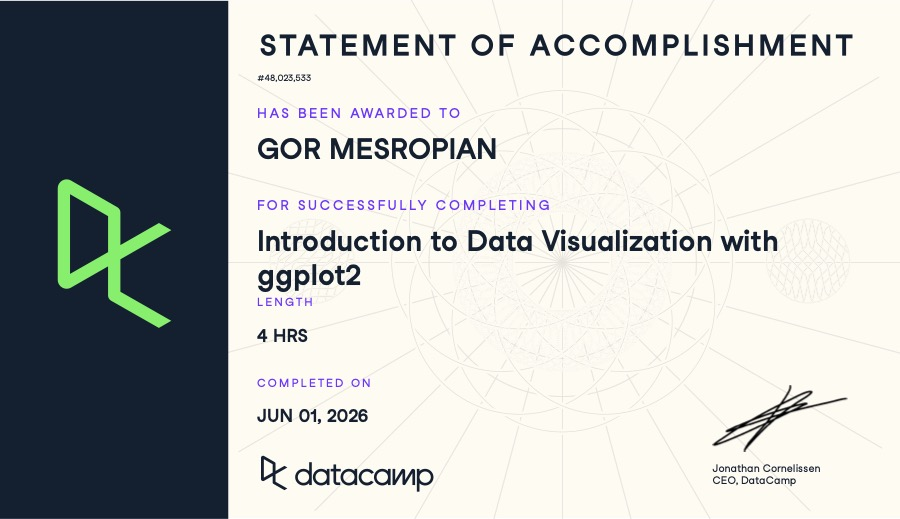

## Part 1: The Campening
(Paste Image of Certificate Below)
<!-- USE THE CODE CHUNK BELOW -->


```{r Question 1}

```


## Part 2: The Penguining

### (a)
<!-- USE THE CODE CHUNK BELOW -->
```{r Question 2a}
#install.packages("palmerpenguins") 
library(palmerpenguins)
data(penguins)
```
<!-- ENTER YOUR EXPLANATION BELOW (USING INLINE R AS YOU WILL) -->

### (b)
<!-- USE THE CODE CHUNK BELOW -->
```{r Question 2b}
head(penguins)
str(penguins)
summary(penguins)
```
<!-- ENTER YOUR EXPLANATION BELOW (USING INLINE R AS YOU WILL) -->

### (c)
<!-- USE THE CODE CHUNK BELOW -->
```{r Question 2c}
penguins2 <- read.table("penguins2.txt", header = FALSE)
penguins2 <- penguins2[, -1] #removing first column
colnames(penguins2) <- colnames(penguins)


#using this command to check if they are the same 
all.equal(penguins, tibble::as_tibble(penguins2))

```
<!-- ENTER YOUR EXPLANATION BELOW (USING INLINE R AS YOU WILL) -->


### (d)
<!-- USE THE CODE CHUNK BELOW -->
```{r Question 2d}
library(ggplot2)
#use geom bar for categorical variables and histogram for continuos data variables 
# Species
ggplot(penguins, aes(x = species)) + geom_bar()

# Island
ggplot(penguins, aes(x = island)) + geom_bar()

# Sex
ggplot(penguins, aes(x = sex)) + geom_bar()

# Year
ggplot(penguins, aes(x = factor(year))) + geom_bar()

# Bill length
ggplot(penguins, aes(x = bill_length_mm)) + geom_histogram()

# Bill depth
ggplot(penguins, aes(x = bill_depth_mm)) + geom_histogram()

# Flipper length
ggplot(penguins, aes(x = flipper_length_mm)) + geom_histogram()

# Body mass
ggplot(penguins, aes(x = body_mass_g)) + geom_histogram()
```
<!-- ENTER YOUR EXPLANATION BELOW (USING INLINE R AS YOU WILL) -->


### (e)
<!-- USE THE CODE CHUNK BELOW -->
```{r Question 2e}
ggplot(penguins, aes(x = flipper_length_mm, fill = species)) +
  geom_histogram()

ggplot(penguins, aes(x = flipper_length_mm, fill = island)) +
  geom_histogram()

ggplot(penguins, aes(x = flipper_length_mm, fill = sex)) +
  geom_histogram()

#the presence of different species explains why the data for flipper length is bimodal, to find this out i essentially tied the color the the species which explains each peak in the histogram
```
<!-- ENTER YOUR EXPLANATION BELOW (USING INLINE R AS YOU WILL) -->

### (f)
<!-- USE THE CODE CHUNK BELOW -->
```{r Question 2f}
ggplot(penguins, aes(x = bill_length_mm, y = bill_depth_mm, color = species)) +
  geom_point() #for bill length and depth, Adelie has the shortest but deep bill, chinstrap has a longer and deeper bill, while gentoo has a long but not deep bill

# flipper length
ggplot(penguins, aes(x = species, y = flipper_length_mm, fill = species)) +
  geom_boxplot()
#for flipper length, Gentoo has the largest by far, then chinstrap is on average sligtly larger than Adelie 
# body mass
ggplot(penguins, aes(x = species, y = body_mass_g, fill = species)) +
  geom_boxplot()
#for body mass, Gentoo is again the highest, Chinstrap and Adelie has similar mass but Adelie penguins tend to have a larger range  
```
<!-- ENTER YOUR EXPLANATION BELOW (USING INLINE R AS YOU WILL) -->

### (g)
<!-- USE THE CODE CHUNK BELOW -->
```{r Question 2g}
ggplot(penguins, aes(x = sex, y = flipper_length_mm, fill = sex)) +
  geom_boxplot() +
  facet_wrap(~ species)

ggplot(penguins, aes(x = sex, y = body_mass_g, fill = sex)) +
  geom_boxplot() +
  facet_wrap(~ species)

# Within every species, males are consistently heavier and have longer flippers than females
```
<!-- ENTER YOUR EXPLANATION BELOW (USING INLINE R AS YOU WILL) -->

### (h)
<!-- USE THE CODE CHUNK BELOW -->
```{r Question 2h}
ggplot(penguins, aes(x = sex, y = bill_length_mm, fill = sex)) +
  geom_violin() +
  geom_boxplot(alpha = 0) +
  facet_wrap(~ species)

#A violon plot shows us the shape of the distributions better but its harder to read the summary statistics as a whole

#Boxplos are good at showing median, spread, and any outlisers but they do not show the distributions 
```
<!-- ENTER YOUR EXPLANATION BELOW (USING INLINE R AS YOU WILL) -->

### (i)
<!-- USE THE CODE CHUNK BELOW -->
```{r Question 2i}
cor(penguins$body_mass_g, penguins$bill_depth_mm, use = "complete.obs")
#returns a -0.47 correlation which means that larger penguins will tend to have less deep bills. Honestly doesnt make too much sense 


#build plot to show relationship 
ggplot(penguins, aes(x = body_mass_g, y = bill_depth_mm)) +
  geom_point() 
#in reality the relationship is a positive orreleation however within each species, when we lump all the species together into one corelation test the result ends up being different due to differences in species size 

```
<!-- ENTER YOUR EXPLANATION BELOW (USING INLINE R AS YOU WILL) -->

### (j)
<!-- USE THE CODE CHUNK BELOW -->
```{r Question 2j}
# TEST: Is flipper length correlated with body mass?
ggplot(penguins, aes(x = body_mass_g, y = flipper_length_mm, color = species)) +
  geom_point() +
  geom_smooth(method = "lm", se = FALSE)

#I want to test for the p value here. to be true we are looking for a value <0.05
cor.test(penguins$body_mass_g, penguins$flipper_length_mm, use = "complete.obs")

#p-value < 2.2e-16 This is really small therefore we accept that flipper length is correlated with body mass


```
<!-- ENTER YOUR EXPLANATION BELOW (USING INLINE R AS YOU WILL) -->
